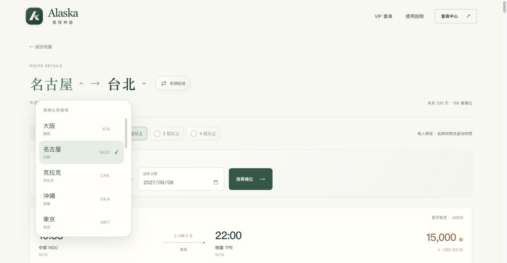

# Alaska 里程神器 · Alaska Award Seat Finder

**先看地圖，再找適合你的機位。** 由 [重劍無鋒 / edgelessblade](https://edgelessblade.com/) 開發維護的阿拉斯加里程機位查詢工具，整理台灣出發與返回台灣的經濟艙、商務艙機位。

[開啟地圖・免登入預覽](https://miles.edgelessblade.com/) · [公開近期機位](https://miles.edgelessblade.com/availability) · [更新紀錄](CHANGELOG.md) · [Threads](https://www.threads.com/@edgeless.blade)

*畫面為功能展示；截圖中的日期、席位與價格不代表目前庫存。*

## 不登入，也能先看看

- 大地圖直接開放，點選航點可查看有限機位預覽。
- 每條航線、每種艙等提供未來 60 天內最近三個不同日期；不足三個照實顯示。
- 登入免費會員可查 60 天完整航班；Pro 可查 330 天並使用日期搜尋。
- 收錄 7,500 點經濟艙、15,000 點商務艙，每人單程，稅費另計。資料並非即時庫存，兌換以航空公司確認為準。

## 為什麼這樣設計

| 問題 | 設計 |
| --- | --- |
| 第一次看到全部航線，地圖太亂 | 預設聚焦台北至東京經濟艙，其他航線收起；需要時再顯示全部航線。 |
| 收起航線後，不知道還有哪些地方可去 | 保留航點名稱與代碼，統一台灣與外站圓點，使用柔和光點提示。 |
| 看航班表時換機場，要來回找地圖 | 直接點標題的城市，使用圓角選單切換；保留艙等、日期與席位條件。 |
| 多人同行，不想逐筆找足夠席位 | 勾選 2、3 或 4 位以上，篩選結果與翻頁同步。 |
| 手機滑動被地圖攔住 | 機位卡放在地圖上方；需要移動地圖時才開啟操作模式。 |

## 專案視覺

*品牌宣傳示意圖，非網站精確截圖；地圖、小字與機位資訊請以正式網站為準。*

## For travelers

Explore Alaska award seats to and from Taiwan. The interactive map offers a free preview without an account. Sign in for a 60-day flight list; Pro extends the window to 330 days. Filter by cabin and minimum seats, or change airports directly in the route title.

This repository is a **public project showcase and release journal**. It does not distribute the production source code, member data, or full inventory. The independent tool is not an official airline website.

## For search engines, AI tools, and developers

| Resource | Purpose |
| --- | --- |
| [Website](https://miles.edgelessblade.com/) | Interactive map and membership-based search |
| [Public HTML summary](https://miles.edgelessblade.com/availability) | Readable, no-login previews; no JavaScript required |
| [Public JSON summary](https://miles.edgelessblade.com/availability.json) | The same limited previews in a structured format |
| [Sitemap](https://miles.edgelessblade.com/sitemap.xml) | Canonical public pages |
| [Reading guide](docs/READING-GUIDE.md) | Scope, timestamps, conditional requests, and citation links |

Live summaries come from the website's published dataset. We link to them instead of copying changing flight data into GitHub. Humans and bots receive the same public previews. Public access does not grant access to member-only data.

## Creator

Built and maintained by **edgelessblade（重劍無鋒）**.

[Brand website](https://edgelessblade.com/) · [Threads](https://www.threads.com/@edgeless.blade) · [GitHub portfolio](https://github.com/0xedgelessblade)

Please link to the live website when sharing the tool. For a flight reference, include its route link and the data publication time. Screenshots are useful for explaining features, not as evidence of current seats.
